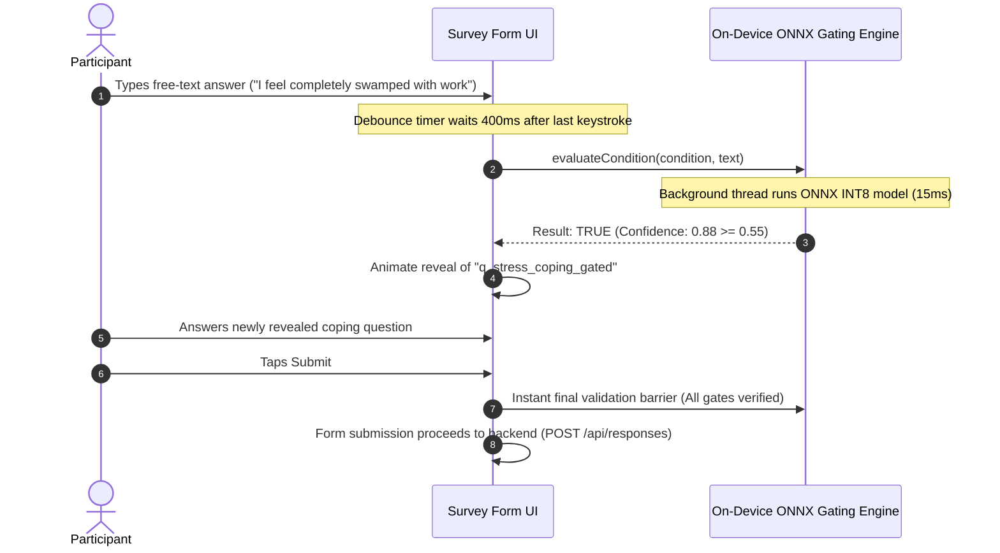

# Frontend Implementation Plan: On-Device Semantic Question Gating (OpenJev)

## 1. System Overview & Objectives
This document establishes the architectural, algorithmic, and engineering specification for **Client-Side Natural Language Question Gating** in the **Simple Surveys Mobile Client** (iOS / Android / React Native / Flutter).

The objective is to enable survey creators to author natural-language gating predicates on survey questions (e.g., *"if <query: response expresses anxiety or stress?>: show coping strategy question"*), evaluated **100% on-device** using **ONNX Runtime Mobile** and a lightweight semantic classifier (OpenJev).

---

### End-to-End System Role: Backend Storage vs. Mobile Execution

The backend and frontend cooperate cleanly without coupling:
1. **Backend as Source of Truth**:
   - Researchers configure questions and optional gating rules when creating/updating surveys.
   - The backend validates, stores, and serves survey definitions containing `gating_rule` blocks via `GET /api/surveys/{survey_id}`.
   - The backend executes **zero** gating decision logic—it functions as a reliable, passive persistence and delivery engine.
2. **Mobile Client as Runtime Evaluator**:
   - The mobile client downloads the survey definition, parses the questions and their `gating_rule` definitions, and executes the on-device OpenJev classifier locally in memory to dynamically reveal or hide questions as the user types.

---

### Architectural Rationale: Why Gating Belongs on Mobile Client CPU
Previously, evaluating natural language gating conditions mid-survey required sending partial answers to a backend API. That architecture was deliberately rejected for the following reasons:

1. **Zero Mid-Survey Latency**:
   - Calling a remote backend while a participant is actively answering introduces network round-trip time (RTT: 200ms–800ms).
   - Evaluating on the device CPU executes in **10ms–35ms**, providing instant question rendering with zero perceived lag.
2. **Elimination of Submit-Button Race Conditions**:
   - In a remote evaluation model, if a user finishes typing and taps "Submit" while a gating request is in flight, the app must either lock the screen with a spinner or risk submitting an incomplete survey before gated questions can appear.
   - On-device synchronous/debounced execution guarantees question visibility is resolved before form submission can proceed.
3. **100% Offline Capability**:
   - Participants frequently fill out Experience Sampling Method (ESM) prompts in subways, flights, or areas with poor cellular connectivity.
   - On-device classification functions completely offline without any internet connection.
4. **Bandwidth & Privacy Preservation**:
   - Participant draft text keystrokes are never transmitted across the network, preserving participant privacy and minimizing device radio battery consumption.

---

## 2. Performance Benchmarks & CPU Inference Profiling

### 2.1. Expected Inference Latency Across Mobile Hardware Tiers
Lightweight zero-shot / semantic entailment classifiers (e.g., OpenJev / MiniLM quantized to INT8) have minimal compute footprints. The table below outlines expected inference execution times for a standard 20–50 word answer:

| Hardware Tier | Representative SoCs / Devices | Expected Inference Latency | Frame Budget Impact |
|---|---|---|---|
| **High-End Flagships** | Apple A16 / A17 / A18 Pro (iPhone 14 Pro+), Qualcomm Snapdragon 8 Gen 2 / Gen 3, Google Tensor G3/G4 | **10ms – 25ms** | Fits well within standard 60fps/120fps thread cycles. Zero UI stutter. |
| **Mid-Tier Devices** | Snapdragon 7 Series, MediaTek Dimensity 8000/9000, Apple A13/A14 (iPhone 11/12) | **25ms – 55ms** | Completely imperceptible when executed on background worker thread. |
| **Low-End / Budget Tier** | Snapdragon 6 Series, MediaTek Helio G80–G99, older budget Android devices | **60ms – 95ms** | Negligible; executed asynchronously off the main UI thread. |

### 2.2. Storage & Memory Footprint
- **Model Bundle Size on Disk**:
  - The quantized INT8 ONNX model bundle (`openjev_classifier_int8.onnx`) and vocabulary tokenizer file consume **$\sim 18\text{MB} – 32\text{MB}$** packaged directly into the mobile application asset bundle.
- **Runtime RAM Allocation**:
  - Initializing the ONNX Runtime session allocates **$\sim 45\text{MB} – 65\text{MB}$** of resident RAM.
  - The session is held as a singleton during survey intake and can be deallocated or kept warm between notification prompts.

### 2.3. Mobile CPU Profiling Methodology
To guarantee that inference does not block the main JavaScript or UI thread, the mobile team must enforce the following profiling regimen before production releases:

```typescript
/**
 * Reference profiling wrapper for mobile performance instrumentation
 */
async function profileGatingInference(
  condition: string,
  answerText: string
): Promise<{ result: boolean; latencyMs: number }> {
  const startTime = performance.now();
  
  // Measure raw CPU execution time off the main thread
  const result = await onnxGatingService.evaluateCondition(condition, answerText);
  
  const latencyMs = performance.now() - startTime;
  
  if (__DEV__) {
    console.log(`[OpenJev Profiler] Latency: ${latencyMs.toFixed(2)}ms | Result: ${result}`);
  }
  
  // Alert if latency exceeds safe threshold
  if (latencyMs > 100) {
    analytics.logWarning('gating_inference_slow', { latencyMs, textLength: answerText.length });
  }
  
  return { result, latencyMs };
}
```

- **Metrics to Track on Test Hardware**:
  1. **Thread Separation**: Ensure ONNX execution occurs on a background worker thread (`WebWorker` for React Native/Web, background isolate for Flutter, or `DispatchQueue.global()` for iOS Swift) so that typing input and cursor blinking maintain an uncompromised 60fps/120fps frame rate.
  2. **Memory Leak Auditing**: Verify that repeated calls to `session.run()` do not leak native tensor allocations.

---

## 3. Technology Stack & Client Runtime

The mobile client leverages official, cross-platform ONNX Runtime bindings:

| Platform / Framework | Package / Dependency | Purpose |
|---|---|---|
| **React Native** | `onnxruntime-react-native` | Direct C++ native bindings for iOS and Android execution. |
| **Flutter** | `onnxruntime` (pub.dev) | FFI bindings to run native ONNX models on mobile devices. |
| **Native iOS (Swift)** | `onnxruntime-objc` / `onnxruntime-swift` | Native CoreML / CPU acceleration via CocoaPods or SPM. |
| **Native Android (Kotlin)** | `com.microsoft.onnxruntime:onnxruntime-android` | Native NNAPI / CPU acceleration via Gradle. |
| **Tokenization** | `@xenova/transformers` or on-device WordPiece/BPE tokenizer | Preprocessing raw text strings into model input tensors. |

### Packaging Assets
- Store model assets in the client app bundle:
  - `assets/models/openjev_gating_int8.onnx`
  - `assets/models/tokenizer.json`
- Ensure model files are configured as bundled assets (not fetched over the network on first start).

---

## 4. Data Contracts & Survey Definition Schema

The backend is the persistent source of truth and delivers the full survey definition to the mobile client via `GET /api/surveys/{survey_id}`. The client parses the survey payload into the following TypeScript contracts:

### 4.1. Question Gating Rule TypeScript Contract

```typescript
export type GatingOperator = 
  | 'openjev_matches'  // Natural language semantic classifier (OpenJev)
  | 'equals'           // Exact match
  | 'greater_than'     // Numeric comparison
  | 'less_than'        // Numeric comparison
  | 'contains';        // Substring / keyword match

export interface QuestionGatingRule {
  /** The question_id of the parent question whose answer gates visibility */
  source_question_id: string;

  /** Evaluation strategy. Default: 'openjev_matches' */
  operator: GatingOperator;

  /** 
   * The natural language hypothesis predicate evaluated by OpenJev.
   * Example: "response expresses feeling overwhelmed, anxious, or stressed"
   */
  natural_language_condition: string;

  /** 
   * Confidence threshold (0.0 to 1.0) required to trigger visibility.
   * Recommended default: 0.55
   */
  threshold: number;
}

export interface QuestionConfig {
  question_id: string;
  prompt: string;
  type: 'rating_scale' | 'single_choice' | 'multiple_choice' | 'text' | 'numeric';
  is_required: boolean;
  validation_rules?: Record<string, any>;
  /** Optional client-evaluated gating condition fetched from backend survey definition */
  gating_rule?: QuestionGatingRule;
}
```

### 4.2. Example Survey JSON Received by Mobile App from Backend (`GET /api/surveys/{survey_id}`)

```json
{
  "survey_id": "daily_wellbeing_adaptive",
  "title": "Daily Well-being Check-in",
  "questions": [
    {
      "question_id": "q_stress_scale",
      "prompt": "On a scale from 1 to 10, how stressed do you feel?",
      "type": "rating_scale",
      "is_required": true,
      "validation_rules": { "min_value": 1, "max_value": 10 }
    },
    {
      "question_id": "q_current_feeling_text",
      "prompt": "In your own words, how do you feel at the moment?",
      "type": "text",
      "is_required": true
    },
    {
      "question_id": "q_stress_coping_gated",
      "prompt": "What strategy or support are you currently using to navigate this feeling?",
      "type": "text",
      "is_required": false,
      "gating_rule": {
        "source_question_id": "q_current_feeling_text",
        "operator": "openjev_matches",
        "natural_language_condition": "response expresses anxiety, high stress, emotional tension, or feeling overwhelmed",
        "threshold": 0.55
      }
    },
    {
      "question_id": "q_open_sharing",
      "prompt": "Is there anything else you want to share right now?",
      "type": "text",
      "is_required": false
    }
  ]
}
```

---

## 5. UI/UX Flow & Evaluation Lifecycle

### 5.1. Evaluation Triggers
To optimize battery and eliminate redundant computation, on-device evaluation does **not** run on every single raw keystroke. Instead, the UI triggers evaluation upon:

1. **Debounced Typing (Primary)**:
   - Evaluates after the user pauses typing for **$350\text{ms} – 500\text{ms}$** in a free-text field.
   - If the user resumes typing before the timer expires, the previous evaluation is cancelled.
2. **Field Blur / Focus Lost**:
   - Triggers immediately when the participant taps outside the text field or advances to another field.
3. **Form "Next" / Step Navigation**:
   - In paginated or stepped questionnaire layouts, evaluation is verified before advancing to the next slide.

### 5.2. Animation & Reveal Behavior
- When a gating condition evaluates to `True`, the gated question dynamically unfolds with an accordion or subtle fade/slide animation ($\sim 250\text{ms}$).
- If the user edits their text and the condition evaluates to `False`:
  - If the gated question was unanswered, it folds closed smoothly.
  - If the user had already typed an answer into the gated question, the UI should retain the draft answer in case the gate is re-triggered.

### 5.3. Solving the Submit Button Edge Case
Because inference runs entirely client-side in $\sim 20\text{ms}$:
- When the user taps the **"Submit"** or **"Next"** button, the client runs an instantaneous synchronous barrier check across all active gating rules using the latest input values.
- If a condition transitions to `True` at the moment of submission, the submission is halted, the gated question appears, and the view smoothly scrolls to highlight the newly revealed question for the participant.
- This guarantees the participant can **never accidentally bypass a gated question** due to in-flight network requests.



---

## 6. Fail-Closed Fallback Strategy

In mobile environments, unpredictable edge cases can occur (e.g., low-memory device termination, corrupted asset extraction, unsupported architecture).

The mobile gating system implements a strict **Fail-Closed Fallback Design**:

1. **Safety Default (`False`)**:
   - If the ONNX runtime fails to initialize, encounters an inference timeout (> 200ms), or throws an unexpected exception, the evaluator **always returns `False`**.
   - The gated question simply remains hidden.
2. **Zero App Crashes**:
   - Gating errors are caught silently in a `try/catch` block, logged to client analytics/diagnostics, and never interrupt the user experience or crash the app.
3. **Unblocked Submissions**:
   - Under no circumstances will a gating evaluation failure prevent the participant from successfully submitting their core survey responses.

```typescript
export class OnDeviceGatingService {
  private session: InferenceSession | null = null;

  async evaluateCondition(
    condition: string,
    answerText: string,
    threshold: number = 0.55
  ): Promise<boolean> {
    // 1. Guard against empty text
    if (!answerText || answerText.trim().length === 0) {
      return false;
    }

    try {
      // 2. Ensure model session is initialized
      const session = await this.getOrCreateSession();
      if (!session) {
        // Fail-Closed: Model unavailable -> return false
        return false;
      }

      // 3. Preprocess and run ONNX model with timeout guard
      const score = await this.runInferenceWithTimeout(session, condition, answerText, 150);
      return score >= threshold;
    } catch (error) {
      // 4. Fail-Closed: Log diagnostics safely and return false
      console.warn('[OnDeviceGating] Evaluation error, defaulting to fail-closed (False):', error);
      return false;
    }
  }
}
```

---

## 7. Mobile Implementation Checklist

- [ ] Add `onnxruntime-react-native` (or platform equivalent) to mobile project dependencies.
- [ ] Place `openjev_classifier_int8.onnx` and tokenizer files in the app bundle assets.
- [ ] Implement `OnDeviceGatingService` singleton with lazy session initialization.
- [ ] Connect debounced input listener (350ms) on text input fields possessing downstream gated dependents.
- [ ] Add smooth accordion animation for revealing/hiding gated question containers.
- [ ] Implement instantaneous pre-submit validation check.
- [ ] Validate on minimum supported Android and iOS test devices using the profiling wrapper.
