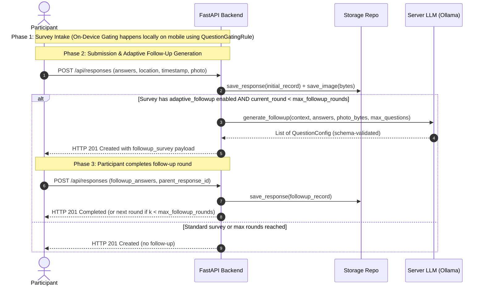

# LLM Feature Implementation Plan: Server-Side Adaptive ESM Surveys

## 1. System Overview & Feature Objectives
This document establishes the technical requirements, domain modeling, and implementation plan for adding **Adaptive Large Language Model (LLM)** capabilities to the **Simple Surveys Backend**.

The objective of this feature is to transform static Experience Sampling Method (ESM) questionnaires into **dynamic, context-aware conversational check-ins** without compromising participant anonymity, latency constraints, or architectural simplicity. All generative model execution is hosted directly on the server to preserve participant device battery, memory, and storage, while ensuring 100% self-hosted data privacy.

---

### Architectural Boundary: Server LLM Follow-Up vs. Mobile Client Gating

To maintain zero mid-survey latency and eliminate race conditions, the survey lifecycle strictly separates client-side decision gating from server-side LLM follow-up generation:

```
┌────────────────────────────────────────────────────────────────────────────────────────┐
│                                 SURVEY LIFECYCLE                                       │
│                                                                                        │
│   Phase 1: During Active Survey Intake                  Phase 2: Post Submission       │
│   ┌─────────────────────────────────────────┐           ┌────────────────────────────┐ │
│   │     Mobile Client (On-Device CPU)       │           │       Server-Hosted LLM    │ │
│   │     (ONNX Runtime Mobile / OpenJev)     │           │   (Generative Synthesis)   │ │
│   │                                         │           │                            │ │
│   │  • Executed purely on mobile CPU.       │           │  • Input: Full survey data │ │
│   │  • Zero network calls while typing.     │           │    (text, ratings, photo,  │ │
│   │  • Unhides pre-existing questions       │           │    location, timestamp).   │ │
│   │    authored in the survey definition.   │           │  • Output: Brand new       │ │
│   │  • See FRONTEND_GATING_PLAN.md          │           │    tailored QuestionConfig │ │
│   │                                         │           │  • Action: Returns Part 2  │ │
│   └─────────────────────────────────────────┘           │    follow-up round.        │ │
│                                                         └────────────────────────────┘ │
└────────────────────────────────────────────────────────────────────────────────────────┘
```

1. **Client-Side Question Gating (Frontend Responsibility)**:
   - Evaluated directly on the participant device using an on-device lightweight semantic classifier (ONNX Runtime Mobile).
   - Dynamically unhides pre-existing questions authored into the survey schema.
   - **Backend Role**: The backend is the single source of truth for storing, persisting, and delivering these rules. The backend schema (`app/schemas/survey_config.py`) includes `QuestionGatingRule` as a passive definition attached to each question, stored in survey definitions (JSON/Firestore) and served to the client via `GET /api/surveys/{survey_id}`.
   - Detailed in `docs/FRONTEND_GATING_IMPLEMENTATION_PLAN.md`.

2. **Server-Hosted LLM (Backend Generative Follow-Up Synthesis)**:
   - Triggers synchronously **after** the survey submission is received at `POST /api/responses`.
   - Synthesizes all submitted data (numeric ratings, free text, location coordinates, timestamp, and surrounding photo).
   - Generates a **brand-new, contextual follow-up question** adhering strictly to the `QuestionConfig` schema, acting in a researcher persona.
   - Returns the follow-up survey payload directly in the HTTP submission response for immediate seamless continuation in the active mobile session.

---

### Core Capabilities
1. **Dynamic Follow-Up Question Generation (Researcher Persona)**:
   - Upon receiving a survey submission with contextual markers (location coordinates, timestamp, numeric ratings, free-form text, and uploaded surroundings photo), the backend queries a server-hosted local LLM to generate at most $N$ (e.g., $N=1$) targeted follow-up question(s).
   - Contextual data (photo bytes and GPS location coordinates) is automatically and guaranteed to be included in the LLM prompt whenever submitted by the mobile client.
   - The original survey data submitted remains completely unchanged and is saved normally. Follow-up submission records are saved and named with the follow-up round suffix: `{timestamp}_resp_{id}_follow-up_{k}` where $k$ is the current follow-up round (1 to $K$).
2. **Synchronous Delivery & Multi-Round Lifecycle**:
   - The backend synchronously evaluates follow-ups during `POST /api/responses`.
   - The HTTP response payload delivers the generated follow-up questions directly to the client device, allowing the participant to seamlessly complete follow-up rounds within their active mobile session.
   - Multi-round conversations are governed by `max_followup_rounds`. The backend tracks depth via the response ID naming convention and automatically halts follow-ups when the limit is reached without requiring the model to manage state.
3. **Pluggable & Swappable Model Architecture (Local Server Only)**:
   - Built on an abstract `BaseLLMProvider` for clean decoupling and extensibility.
   - Powered by open-weights models served locally on backend infrastructure via Ollama, vLLM, or llama.cpp (e.g., Llama 3.2 3B/8B, Mistral, or LLaVA for vision) to guarantee 100% data privacy and eliminate third-party cloud API costs.
4. **Schema-Constrained Generation (Zero Hallucination)**:
   - LLM generation uses JSON schema enforcement and grammar constraints. Generated questions strictly conform to the existing `QuestionConfig` Pydantic model (`rating_scale`, `text`, `single_choice`, etc.), identical in structure to files in `data/surveys/`.

---

## 2. Architectural Conventions & Design Patterns

Conforming with the backend's standard FastAPI/Python structure, the LLM integration introduces dedicated layers under `app/`:

| Layer | Directory | Purpose |
|---|---|---|
| **API Endpoints** | `app/api/` | Ingestion of multi-stage responses and follow-up payload delivery. |
| **LLM Services** | `app/services/llm/` | Prompt engineering, context bundling, output parsing, and researcher agent orchestration. |
| **Model Providers** | `app/services/llm/providers/` | Concrete drivers for local server inference (Ollama, vLLM, llama.cpp). |
| **Schemas (DTOs)** | `app/schemas/llm.py` | Strongly typed contracts for follow-up prompts and adaptive survey configurations. |
| **Survey Schemas** | `app/schemas/survey_config.py` | Holds `QuestionConfig` and `QuestionGatingRule` definitions for persistence and delivery. |

### SOLID Design & OOP Patterns
- **Single Responsibility (SRP)**: The prompt formatting and reasoning logic are strictly separated from raw model HTTP communication.
- **Open/Closed Principle (OCP)**: Adding new local runners or inference microservices requires adding a new `BaseLLMProvider` subclass without modifying existing endpoints.
- **Dependency Inversion (DIP)**: Controllers and response-submission workflows depend solely on the abstract interface `BaseLLMProvider`, injected via FastAPI's `Depends` container.

---

## 3. Technology Stack & Dependencies

| Library | Version / Type | Purpose |
|---|---|---|
| **httpx** | `>= 0.27.0` | High-throughput asynchronous HTTP client for calling local Ollama or vLLM server inference microservices. |
| **Pydantic** | `>= 2.6.0` | Structured JSON output parsing (guaranteeing valid follow-up question schemas from LLM output). |

---

## 4. System Sequence & Execution Flow



---

## 5. Schemas & Data Contracts

### 5.1. Question Gating Rule Passive Storage Contract (`app/schemas/survey_config.py`)
Although evaluated exclusively by the client device, the gating rule is formally part of the survey definition stored by the backend and returned in survey endpoints:

```python
from typing import Literal, Optional
from pydantic import BaseModel, ConfigDict, Field

GatingOperator = Literal[
    "openjev_matches",
    "equals",
    "greater_than",
    "less_than",
    "contains",
]

class QuestionGatingRule(BaseModel):
    """
    Client-evaluated gating condition attached to a survey question.
    Stored and served by the backend; evaluated on-device by the mobile client.
    """
    model_config = ConfigDict(extra="ignore")

    source_question_id: str = Field(..., description="ID of the parent question whose answer determines visibility")
    operator: GatingOperator = Field("openjev_matches", description="Evaluation operator ('openjev_matches' for semantic model)")
    natural_language_condition: Optional[str] = Field(None, description="Hypothesis predicate for OpenJev")
    threshold: float = Field(0.55, description="Confidence threshold (0.0 to 1.0)")

# Attached to QuestionConfig:
class QuestionConfig(BaseModel):
    question_id: str
    prompt: str
    type: Literal["rating_scale", "single_choice", "multiple_choice", "text", "numeric"]
    is_required: bool = True
    validation_rules: Optional[Dict[str, Any]] = None
    gating_rule: Optional[QuestionGatingRule] = Field(
        None,
        description="Optional client-evaluated gating condition"
    )
```

### 5.2. Adaptive Follow-Up Configuration & Result Schemas (`app/schemas/llm.py`)

```python
from typing import List, Optional
from pydantic import BaseModel, Field
from app.schemas.survey_config import QuestionConfig

class AdaptiveFollowUpConfig(BaseModel):
    """Configuration attached to SurveyConfig to control LLM follow-ups."""
    enabled: bool = Field(False, description="Whether to trigger an LLM follow-up round")
    max_questions_per_round: int = Field(1, ge=1, le=3, description="Maximum follow-up questions generated per round")
    max_followup_rounds: int = Field(1, ge=1, le=5, description="Maximum number of conversational follow-up rounds allowed")
    researcher_prompt: Optional[str] = Field(
        None,
        description="Custom system instructions framing the researcher's focus (e.g., 'Probe on coping mechanisms')."
    )
    provider_override: Optional[str] = Field(
        None,
        description="Optional override for model provider runner ('ollama', 'vllm', 'local')"
    )

class FollowUpSurveyPayload(BaseModel):
    """Dynamic follow-up survey returned in response to initial survey completion."""
    parent_response_id: str
    survey_id: str
    round_number: int = Field(1, description="Current follow-up round index (1 to max_followup_rounds)")
    title: str = "Follow-up Questions"
    researcher_message: Optional[str] = Field(
        None, 
        description="A brief personalized message from the researcher acknowledging the participant's situation"
    )
    questions: List[QuestionConfig] = Field(
        ...,
        description="Questions adhering strictly to app.schemas.survey_config.QuestionConfig"
    )
```

### 5.3. Extended Response Submission Schema (`app/schemas/survey_response.py`)

```python
from typing import Literal, Optional
from datetime import datetime
from pydantic import BaseModel, Field
from app.schemas.llm import FollowUpSurveyPayload

class SurveyResponseSubmissionResult(BaseModel):
    response_id: str
    survey_id: str
    status: Literal["COMPLETED", "EXPIRED"]
    status_message: Optional[str] = None
    message: Optional[str] = None
    image_stored: bool = False
    image_filename: Optional[str] = None
    received_at: datetime
    # Adaptive ESM Follow-Up Field:
    followup_survey: Optional[FollowUpSurveyPayload] = Field(
        None,
        description="Populated if the completed survey triggered an adaptive follow-up round."
    )
```

---

## 6. Provider Abstractions & Interfaces

### 6.1. Abstract LLM Provider (`app/services/llm/base.py`)

```python
from abc import ABC, abstractmethod
from typing import List, Optional, Tuple
from app.schemas.survey_config import QuestionConfig
from app.schemas.survey_response import SurveyResponseRecord

class BaseLLMProvider(ABC):
    """Abstract interface for server-side LLM question generation."""

    @abstractmethod
    async def generate_followup_questions(
        self,
        survey_title: str,
        response_record: SurveyResponseRecord,
        photo_bytes: Optional[bytes] = None,
        photo_media_type: Optional[str] = None,
        max_questions: int = 1,
        system_instruction: Optional[str] = None,
    ) -> Tuple[Optional[str], List[QuestionConfig]]:
        """
        Takes the full participant submission context and returns:
        (researcher_message, list_of_followup_questions).
        
        Guarantees that each returned question adheres to QuestionConfig schema.
        """
        pass
```

### 6.2. Local Server LLM Provider (`app/services/llm/providers/local_server_provider.py`)
- Communicates with a server-hosted inference runner via HTTP (e.g., Ollama at `http://localhost:11434/api/generate` or OpenAI-compatible endpoint at `http://localhost:8000/v1/chat/completions`).
- Supports local open-weights models (e.g., Llama 3.2 3B/8B, Mistral, or LLaVA for multimodal visual context).
- Uses guided JSON schema decoding / GBNF grammar constraints to enforce valid `QuestionConfig` outputs, matching the structure of `data/surveys/*.json`.
- Automatically supplies photo bytes and location coordinates whenever they exist in the incoming submission payload.
- Keeps 100% of survey responses and photos strictly inside the server boundary.

---

## 7. Performance Benchmarking & Host Feasibility

### Inference Feasibility on Server Host
| Model / Pipeline | Host Requirement | Inference Latency | Viability in Live API |
|---|---|---|---|
| **Small Local LLM (Llama 3.2 1B/3B Q4)** | 4 vCPU, 4GB RAM | ~900ms – 1800ms | **Viable for synchronous follow-up generation** |
| **Local Vision-Language (LLaVA 7B Q4)** | 8 vCPU / GPU (CUDA/MPS) | ~1500ms – 4000ms | **Viable with GPU or quantized text-first CPU fallback** |

---

## 8. API Endpoint Specifications

### 8.1. Survey Response Ingestion with Synchronous Follow-Up
`POST /api/responses`
- **Behavior**:
  1. Validates and persists the initial response record and optional photo.
  2. Inspects `adaptive_followup` on the survey definition:
     - Checks if `enabled == true`.
     - Determines the current round index $k$ from the response chain naming convention:
       - Initial response: `resp_8f4a1c9e` ($k=0$)
       - First follow-up: `resp_8f4a1c9e_follow-up_1` ($k=1$)
     - If $k < \text{max\_followup\_rounds}$:
       - Dispatches context (answers, location, photo bytes) to the active server-hosted `BaseLLMProvider`.
       - Generates follow-up questions strictly formatted as `QuestionConfig`.
       - Returns HTTP 201 with `followup_survey` embedded in the response payload.
  3. If false or max rounds reached, returns standard submission confirmation without a `followup_survey`.

### 8.2. Submitting Follow-Up Responses
`POST /api/responses`
- Follow-up responses are submitted using the existing endpoint, setting `response_id = {timestamp}_resp_{parent_id}_follow-up_{k}` and linking back to the initial survey.

---

## 9. Example Adaptive Survey Definition JSON

```json
{
  "survey_id": "daily_wellbeing_adaptive",
  "title": "Daily Well-being & Environment Check-in",
  "description": "Adaptive check-in that conditionally reveals questions on-device and generates a researcher follow-up post-submission.",
  "is_active": true,
  "adaptive_followup": {
    "enabled": true,
    "max_questions_per_round": 1,
    "max_followup_rounds": 1,
    "researcher_prompt": "You are an empathetic behavioral health researcher. Based on the participant's stress score, free-text mood explanation, and current surroundings photo, formulate exactly ONE thoughtful follow-up question to probe what environmental or interpersonal factors contributed most to their current state."
  },
  "questions": [
    {
      "question_id": "q_stress_scale",
      "prompt": "On a scale from 1 (completely calm) to 10 (extremely stressed), how stressed do you feel?",
      "type": "rating_scale",
      "is_required": true,
      "validation_rules": {
        "min_value": 1,
        "max_value": 10,
        "step": 1,
        "min_label": "Completely Calm",
        "max_label": "Extremely Stressed"
      }
    },
    {
      "question_id": "q_current_feeling_text",
      "prompt": "In your own words, how do you feel at the moment?",
      "type": "text",
      "is_required": true
    },
    {
      "question_id": "q_stress_coping_gated",
      "prompt": "What strategy or support are you currently using to navigate this feeling?",
      "type": "text",
      "is_required": false,
      "gating_rule": {
        "source_question_id": "q_current_feeling_text",
        "operator": "openjev_matches",
        "natural_language_condition": "response expresses anxiety, high stress, emotional tension, or feeling overwhelmed",
        "threshold": 0.55
      }
    },
    {
      "question_id": "q_open_sharing",
      "prompt": "Is there anything else you want to share right now?",
      "type": "text",
      "is_required": false
    }
  ]
}
```

---

## 10. Configuration & Environment Variables

```dotenv
# LLM Provider Configuration (Server-Side Local Only)
LLM_PROVIDER=ollama                     # Options: "ollama", "vllm", "mock"
LLM_MODEL_NAME=llama3.2:3b              # Or "mistral:7b", "llava:7b"
LOCAL_LLM_URL=http://localhost:11434    # Server-local inference endpoint
```

---

## 11. Resilience, Fallbacks & Anonymity Safeguards

1. **Timeout & Failure Fallback**:
   - LLM generation runs under an aggressive timeout (e.g., $2.5$ seconds).
   - If the local LLM server fails, times out, or returns malformed JSON, the backend catches the exception, logs a warning, and returns the response with `followup_survey: null`. The participant's initial survey response remains completely saved and intact.
2. **Schema Enforcement & Zero Hallucination**:
   - Local LLM output is forced via guided JSON decoding (e.g., Ollama `format="json"` or grammar constraints) into Pydantic models.
   - Any question generated must pass `QuestionConfig` validation. If the LLM generates unsupported types or invalid properties, the response is discarded or sanitized before it can ever reach the mobile app.
3. **Strict Anonymity Filter**:
   - Context sent to the LLM contains **zero participant identifiers**, device tokens, IP addresses, or permanent IDs.
   - Only ephemeral coordinates, timestamps, and question responses are provided.
4. **Guardrails & Content Safety**:
   - System prompts forbid generating offensive, diagnostic, medical, or invasive questions. Follow-up outputs are strictly validated against `QuestionConfig` schemas before transmission.
